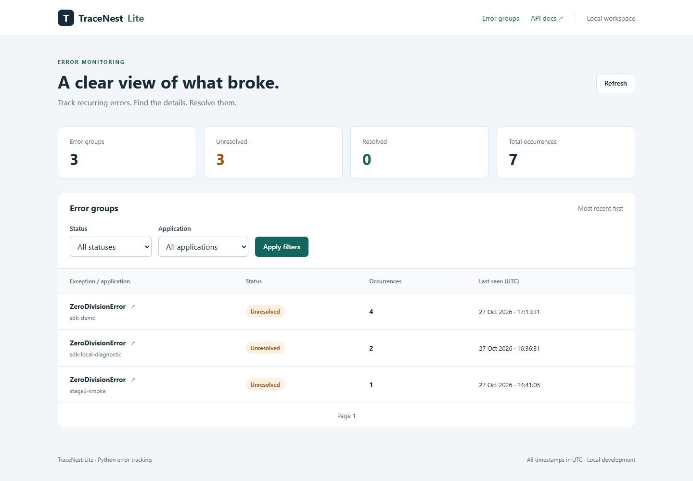
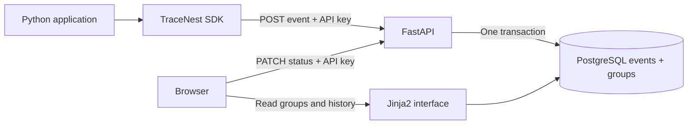

# TraceNest Lite

A compact error tracking service built with FastAPI, SQLAlchemy,
and PostgreSQL.
Capture Python exceptions, group recurring errors, and inspect tracebacks
in a local web interface. Includes an installable SDK, PostgreSQL migrations,
tests, Ruff checks, and GitHub Actions. Licensed under MIT.

Built as a small modular monolith inspired by error trackers such as Sentry.
It is a local development demo, not a production monitoring service.

## Start on Windows (Git Bash)

Install and start Docker Desktop, then in this directory run:

```bash
# First launch only; keep your existing .env when upgrading.
cp .env.example .env
docker compose up --build -d
curl -sS http://localhost:8000/health
```

Expected response: `status: ok`, `database: ok`.
API documentation: <http://localhost:8000/docs>.
Web interface: <http://127.0.0.1:8000/>.

Stop with `docker compose down`. Data is retained in a Docker volume.
The example credentials are for local development only.

## Send and retrieve an event

Set `TRACENEST_API_KEY` in `.env` to change the ingestion key, then run
`docker compose up -d api`. The default local key is `development-key`,
so an existing stage 1 `.env` still works. Never commit `.env` or real keys.
Use your configured key below if you changed it:

```bash
curl -sS -X POST http://localhost:8000/api/v1/events \
  -H 'Content-Type: application/json' \
  -H 'X-API-Key: development-key' \
  -d '{
    "exception_type": "ZeroDivisionError",
    "message": "division by zero",
    "traceback": "ZeroDivisionError: division by zero",
    "application": "demo",
    "created_at": "2026-10-27T12:00:00Z"
  }'

curl -sS 'http://localhost:8000/api/v1/events?limit=20&offset=0'
# Replace EVENT_ID with the UUID returned by POST:
curl -sS http://localhost:8000/api/v1/events/EVENT_ID
```

POST returns `201` and the saved event, including its UUID and `group_id`.
The latter links the event to an error group. The list uses
occurrence time (`created_at`) descending, then UUID descending to break ties.
`limit` defaults to 20 (maximum 100); `offset` defaults to 0.

Required fields: `exception_type`, `message`, `traceback`, `created_at`.
`application` is optional. `created_at` must include a timezone and is
normalized to UTC. Empty exception messages are accepted.
Unknown fields and null bytes are rejected.

Limits: exception type/application 200 characters; message 10,000; traceback
50,000; entire request body 128 KiB, including requests without Content-Length.
Unicode-heavy payloads can reach the byte limit before the character limits.

Errors: `401` for a missing/incorrect ingestion key; `404` for unknown events;
`413` for oversized bodies; `422` for validation; `503` for database errors.
Use Swagger's **Authorize** button to provide `X-API-Key` for POST requests.

## Python SDK

Install the standalone SDK in your application's Python 3.12+ environment.
From the repository root in Git Bash:

```bash
python -m pip install ./sdk
python examples/capture_exception.py
curl -sS 'http://localhost:8000/api/v1/events?limit=20'
```

The example sends a real `ZeroDivisionError` with `application: "sdk-demo"`.
It prints a success message and exits with code 0 when the API accepts it.
The server should already be running. If you changed its key, first run:

```bash
export TRACENEST_API_KEY='your-local-key'
# Optional; the example defaults to this URL:
export TRACENEST_URL='http://127.0.0.1:8000'
```

The example reads shell environment variables, not the server's `.env` file.
Its default URL uses `127.0.0.1`, matching the Compose IPv4 port binding.
This avoids a delayed IPv6 connection attempt to `localhost` on Windows.
Use the SDK in your application:

```python
from tracenest_sdk import TraceNestClient

with TraceNestClient(
    url="http://127.0.0.1:8000",
    api_key="development-key",
    application="my-app",
) as client:
    try:
        1 / 0
    except Exception as exc:
        delivered = client.capture_exception(exc)
```

`capture_exception` returns `True` for HTTP 201 and `False` for capture,
network, or HTTP failures. It does not raise those errors or log API keys.
On failure, `client.last_error` contains a safe diagnostic: `HTTP <status>`,
`timeout`, `network_error`, `capture_error`, or `invalid_exception`.
It is reset on each capture; response bodies and exception text are omitted.
The example prints the diagnostic and configuration sources on failure.
Shell exports override the example defaults; `.env` is used by Compose only.
After SDK changes, update your local installation:

```bash
python -m pip install -e ./sdk
```

Invalid constructor configuration raises `ValueError`. Reuse one client
and close it with a context manager or `client.close()` at shutdown.

Sending is synchronous, with a two-second HTTPX timeout per network phase.
There is no background queue, retry, or delivery guarantee. The client does
not follow redirects. It collects the exception and traceback, without
capturing local variables or environment variables. Error messages and
source lines can still contain information from your application.

Long messages and tracebacks are truncated to fit API limits; traceback
trimming preserves the end. Null bytes are removed. A timezone-aware UTC
timestamp is recorded when `capture_exception` is called.

## Error groups

Events remain individually available, while matching events share a group:

```bash
curl -sS 'http://127.0.0.1:8000/api/v1/groups?limit=20'
curl -sS 'http://127.0.0.1:8000/api/v1/groups?status=unresolved'
# Replace GROUP_ID with a UUID from the group list:
curl -sS http://127.0.0.1:8000/api/v1/groups/GROUP_ID
curl -sS http://127.0.0.1:8000/api/v1/groups/GROUP_ID/events

curl -sS -X PATCH http://127.0.0.1:8000/api/v1/groups/GROUP_ID \
  -H 'Content-Type: application/json' \
  -H 'X-API-Key: development-key' \
  -d '{"status":"resolved"}'
```

Group fields: `id`, `fingerprint`, `exception_type`, `application`,
`occurrences`, `first_seen`, `last_seen`, and `status`.
Status is `unresolved` or `resolved`. PATCH requires the ingestion API key.
Any newly received occurrence reopens a resolved group, even if its event
timestamp is older. This is a local demo, with no separate user/admin roles.

Group lists accept `status`, `application`, `limit` (1-100, default 20), and
`offset`. They sort by `last_seen`, then UUID, descending. Group history uses
the same pagination and chronological ordering as the event list.

Fingerprint v1 hashes the application, exception type, and ordered Python
stack frames (filename basename and function). It ignores absolute directory
prefixes, line numbers, source lines, and error messages when frames exist.
Thus moving a project or adding lines does not split an otherwise equal
stack. If no frames can be parsed, the exact message is used instead.

These are deliberately simple rules: files sharing the same basename and
function can merge, changed call stacks can split, and arbitrary/nonstandard
traceback formats fall back to the message. Original events are preserved.
Treat `app/fingerprint_v1.py` as versioned: changing it requires a new
fingerprint version and an explicit data migration.

PostgreSQL `INSERT ... ON CONFLICT DO UPDATE` updates occurrence counts and
first/last timestamps atomically. Group updates and event inserts commit in
one transaction, so failed event writes cannot inflate counters. Concurrent
status updates and event ingestion are ordered by PostgreSQL row locks.

## Web interface

Open <http://127.0.0.1:8000/> after starting the API. The dashboard shows
workspace totals and error groups with application/status filters and
pagination. Click an exception to inspect its traceback and event history.
Click a timestamp in the history to inspect that specific occurrence.
All displayed timestamps are UTC. Refresh the page to see new events.

To resolve or reopen a group, enter your ingestion API key in the group
page, choose a status, and select **Save status**. JavaScript sends the
existing authenticated PATCH request. The key is cleared from the input
and is not stored in cookies, browser storage, or page HTML. An incorrect
key displays an error without changing the status. Browsing works without
JavaScript; status updates require it (or use the REST API).

The UI uses server-rendered Jinja2 templates, local CSS, and a small vanilla
JavaScript file. There is no frontend build or external asset dependency.
Exception text is HTML-escaped. This remains a local development interface,
not a public service with user accounts or access control for viewing data.



[Group details](docs/screenshots/group-detail.png) ·
[Mobile dashboard](docs/screenshots/dashboard-mobile.png)

## Database upgrades

Application startup runs `alembic upgrade head` using the same connection
and transaction as a PostgreSQL advisory lock. Multiple application starts
cannot run migrations at the same time. Startup fails if migration fails.

To upgrade an existing stage 2/3 instance:

```bash
docker compose up --build -d api
curl -sS http://127.0.0.1:8000/health
curl -sS http://127.0.0.1:8000/api/v1/groups
```

Revision `0001_events` adopts the original events table (or creates it on
an empty database). Revision `0002_groups` creates groups, backfills events
in batches, and adds a required foreign key. Existing event UUIDs, payloads,
and timestamps are preserved. Repeated startup does not recount events.
The entire upgrade rolls back if any step fails.

Keep the existing Docker volume; do not run `docker compose down -v`.
Recreate the old API during the upgrade: older versions cannot insert events
once `group_id` becomes required. Backfilling locks the event table, so allow
maintenance time for a larger database and take your normal database backup.
Destructive downgrades are intentionally unsupported.

## Local proxy troubleshooting (Git Bash)

If HTTPX receives HTTP 403 through your proxy but a direct local request
works, add loopback addresses to proxy exclusions in the current terminal:

```bash
export NO_PROXY="${NO_PROXY:+$NO_PROXY,}localhost,127.0.0.1,::1"
export no_proxy="${no_proxy:+$no_proxy,}localhost,127.0.0.1,::1"
python examples/capture_exception.py
```

This preserves existing exclusions. It is only needed in affected proxy
environments and is not a required TraceNest installation step.

## Development checks and CI

```bash
docker compose --profile test run --build --rm tests
```

This runs the same checks as `.github/workflows/ci.yml`:

1. Ruff linting and import ordering.
2. Pytest with PostgreSQL.
3. SDK source distribution and wheel builds.

Formatting verification is optional and is not run by the check script.
There is no separate line-length check for project configuration files.
The current Ruff lint rules include `E501` for Python line length, with a
configured limit of 79 characters.

To run only tests:

```bash
docker compose --profile test run --rm tests python -m pytest -q
```

Optional local tooling in your active Python 3.12+ virtual environment:

```bash
python -m pip install -r requirements-dev.txt
python -m pip install -e ./sdk
python -m ruff check .
python -m ruff format --check .
```

To apply formatting/import fixes, use `python -m ruff check --fix .` and
`python -m ruff format .`, then rerun checks. Configuration lives in the root
`pyproject.toml`; `.editorconfig` and `.gitattributes` align editor settings
and line endings across Windows and Linux. Ruff is pinned so formatting
does not change silently between installations.

The GitHub workflow runs on pushes, pull requests, and manual dispatch.
It builds the API image and runs the test image with an isolated PostgreSQL
service and disposable CI credentials. It requires no repository secrets.
Its cleanup removes only the CI environment on the GitHub runner.

Pytest runs API tests against PostgreSQL. Each test creates and removes its own
random schema; application tables are not modified. Tests cover persistence,
authentication, validation, ordering, pagination, and error responses.
SDK tests cover payloads, timeouts, redirects, network failures, cleanup,
large Unicode messages, and delivery through the API into PostgreSQL.
Grouping tests include concurrent HTTP ingestion, transaction rollback,
status transitions, filtering, and history. Migration tests cover empty and
legacy databases, multiple backfill batches, repeat startup, and rollback.
UI tests cover HTML rendering, filters, pagination, traceback escaping,
event selection, and missing/unavailable data.
The database user needs schema creation permission; the Compose user has it.

`requirements.txt` contains API dependencies. Test, SDK test, lint, and build
tools are in `requirements-dev.txt`; the SDK declares HTTPX independently
in `sdk/pyproject.toml`. There is no need to install development tools in
your local environment when using the Docker check command.

## Architecture



Each accepted event updates its group and inserts its own history record
in one database transaction. PostgreSQL resolves concurrent updates using
the fingerprint uniqueness constraint. Alembic upgrades the database before
the API accepts requests. The interface queries the same tables as the API.
No message broker, worker service, or frontend build is required.

## Structure and current limitations

- `app/main.py`: application factory, startup, health, database error handling.
- `app/models.py`: SQLAlchemy event and error group tables.
- `app/schemas.py`: input validation and response schema.
- `app/events.py`: authentication, database sessions, and event routes.
- `app/groups.py`: group listing, history, and status routes.
- `app/ui.py`, `app/templates/`, `app/static/`: local Jinja2 interface.
- `app/grouping.py`: atomic PostgreSQL group updates.
- `app/fingerprint_v1.py`: versioned fingerprint algorithm.
- `app/migrations.py`, `migrations/`: migration runner and revisions.
- `app/middleware.py`: request body size limit before JSON parsing.
- `sdk/`: independently installable `tracenest-sdk` package using HTTPX.
- `examples/capture_exception.py`: runnable SDK example.
- `scripts/check.py`, `pyproject.toml`: shared checks and code style.
- `.github/workflows/ci.yml`: CI using the same Docker checks.

Schema changes are managed by Alembic. Keep existing database volumes.

This is a local development demo, not a public SaaS. Read endpoints and Swagger
are unauthenticated, and tracebacks may contain sensitive information. Compose
binds the API to `127.0.0.1`; keep it local. Retention policies and rate
limiting are not implemented yet.

## Release preparation

Before committing, review `git status --short` and confirm that `.env`,
virtual environments, caches, and build output are ignored. Commit
`.env.example` with local example credentials only.

Run the Docker check command above, then review the GitHub Actions result
for the commit you intend to release. The repository owner publishes tags
and GitHub releases manually. Release notes for the initial version are in
[docs/releases/v0.1.0.md](docs/releases/v0.1.0.md).

The check script builds the SDK wheel and source distribution in `dist/sdk`
inside the test container. The standard `--rm` command removes that container
and its build output. To keep archives on the host, run this from the
repository root after installing the optional local tooling:

```bash
python -m build --no-isolation --outdir dist/sdk sdk
```

GitHub Actions validates these builds but does not upload release assets.
No GitHub release, PyPI publication, or external deployment is automatic.

## License

[MIT](LICENSE). The SDK also ships its license in its distribution archives.
